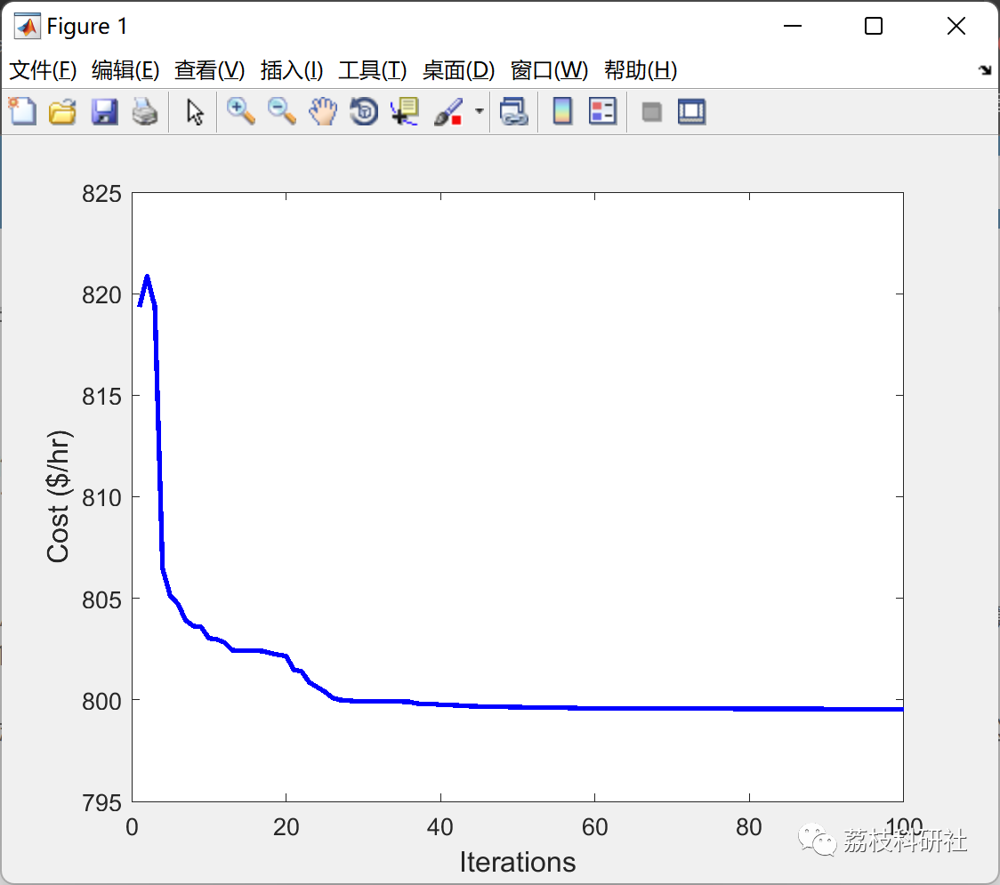

# Optimal Power Flow Based on Particle Swarm Optimization Algorithm (IEEE30 Nodes - MATLAB Code Implementation)

💥💥💞💞 Welcome to this blog❤️❤️ 💥💥
🏆 Bloggers' Advantages: 🌞🌞🌞 The content of the blog strives for rigorous thinking and clear logic to facilitate readers.
⛳️ Mantra: A journey of a thousand miles is begun with a single step.
Litchi Research Society
Code Collection: Power Systems, Intelligent Algorithms and Applications, Neural Network Prediction, Path Planning, Optimized Scheduling, Workshop Scheduling, Image Processing, Signal Processing...
🎁 Special Section Links:
🌈🌈🌈🌟🌟🌟 Electrical Code Intelligent Algorithms and Their Applications Path Planning Neural Network Prediction Optimized Scheduling Image Processing Workshop Scheduling Signal Processing Romantic Her Thoughts Math Modeling Complete Code Issues
💥1 Overview
The optimal power flow (OPF) problem is important in the operation of power systems. The goal of OPF is to determine the best operational state of the power system by optimizing certain objectives while satisfying certain operational constraints.
This article explains how to use metaheuristic methods to solve OPF problems.
📚2 Run Results
🎉3 References
[1] Bouchekara, H. R. E. H. "Optimal Power Flow Using Black-Hole-Based Optimization Approach." Applied Soft Computing, vol. 24, Elsevier BV, Nov. 2014, pp. 879–88, doi:10.1016/j.asoc.2014.08.056.
[2] Bouchekara, H. R. E. H., et al. "Optimal Power Flow Using Teaching-Learning-Based Optimization Technique." Electric Power Systems Research, vol. 114, Elsevier BV, Sept. 2014, pp. 49–59, doi:10.1016/j.epsr.2014.03.032.  
🌈4 Matlab Code Implementation  
​  
Click the article's lower left corner to read more.

## Images

<!-- PAYMENT_BLOCK -->

## Get this dataset

- Payment link (Stripe): [Buy now](https://buy.stripe.com/3cs8yP7sY87d0vu9AB)
- Payment QR code: 

<!-- /PAYMENT_BLOCK -->
